<p align="center">
  <a href="https://wantre.github.io/better-grokbot/"></a>
</p>

<h1 align="center">Better GrokBot</h1>

<p align="center">
  Grok Bot, avec un châssis complet, en huit langues : rail de navigation, Chat IA, navigateur Web, palette <kbd>Ctrl</kbd> <kbd>K</kbd>, barre Répond vers d’autres IA, quotas en direct, plugins isolés et mises à jour automatiques.<br>
  <a href="https://wantre.github.io/better-grokbot/"><b>Voir le site</b></a> · <a href="https://github.com/Wantre/better-grokbot/releases/latest/download/Patch-GrokBot.exe"><b>Télécharger Patch GrokBot</b></a> (dernière version) · <a href="https://discord.gg/D7CB6UePFD">Discord</a>
</p>

---

Ce dépôt contient la page de présentation de Better GrokBot, publiée avec GitHub Pages, son manifeste de mise à jour et ses notes de version. Les paquets sont sur la page des versions.

Better GrokBot est une **copie privée** de Grok Bot. L’installation d’origine, dans `Programs\Grok Bot`, est lue sans jamais être modifiée. La copie vit à part et se retire en un clic.

## Installer ou mettre à jour

**[Télécharger Patch-GrokBot.exe](https://github.com/Wantre/better-grokbot/releases/latest/download/Patch-GrokBot.exe)**, puis lancez-le. Le patcher récupère la dernière version, vérifie son empreinte SHA-256, ferme Grok Bot, garde la version actuelle pour un retour arrière, applique le patch et relance Grok Bot. Il sert à la première installation comme aux mises à jour, et le bouton « Mettre à jour » de l’app passe par lui.

<p align="center">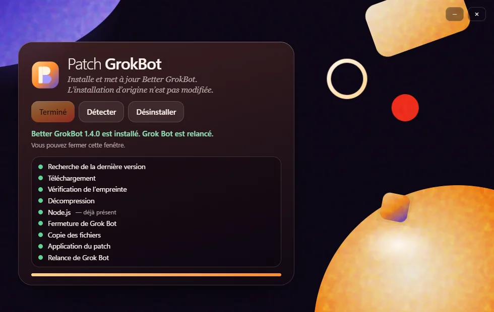</p>

Le fichier n’est pas signé : Windows peut afficher SmartScreen (« Windows a protégé votre PC »). Cliquez « Informations complémentaires », puis « Exécuter quand même ». Les empreintes de chaque fichier sont dans `SHA256SUMS`. Le paquet `.zip` reste disponible sur la [page des versions](https://github.com/Wantre/better-grokbot/releases/latest) pour une installation hors ligne.

**Depuis la 1.3** : le bouton de mise à jour de la 1.3 ne peut pas passer en 1.4. Lancez Patch-GrokBot.exe : vos réglages, notes et prompts sont gardés.

## Nouveau dans la 1.7

- **Tuiles façon Hyprland** : plusieurs applications avec Grok, neuf espaces, cinq dispositions, raccourcis Alt+Maj, fenêtres flottantes, sessions et règles.
- **Terminal et explorateur de fichiers** intégrés (Ctrl+Maj+X).
- **Extensions Chrome** dans le volet Web (lien du Web Store, .crx ou dossier), prise en charge partielle.
- **Agent IA** : il voit une tuile ou une page, propose une action, vous confirmez ; jamais de mot de passe, ni de banque.
- **Mode Bureau** : plein écran et démarrage avec Windows.

### De la 1.7.1 à la 1.7.8

- **Tuiles repensées** : Barres de titre dans le thème, barre des tuiles, réduction, menu par tuile et bouton « Fenêtre » avec recherche. L’agent IA est désormais dans le Chat IA.
- **Chaque application dans sa tuile** : La taille minimale de chaque application est respectée. Pendant un redimensionnement ou un déplacement, une image floutée remplace la fenêtre.
- **Plus stable** : Les fenêtres ne disparaissent plus quand vous cliquez sur Better, les onglets répondent, et le clignotement blanc après un redimensionnement est corrigé. La notification de disposition reste visible.
- **Disposition mémorisée** : À la réouverture de Better, les applications accrochées qui sont encore ouvertes reprennent leur place. Aucune application n’est lancée pour cela.
- **Bloqueur de publicités** : Il utilise EasyList, EasyPrivacy et d’autres listes, mises à jour automatiquement : 125 éléments bloqués sur 130 lors de notre essai sur adblock.turtlecute.org. Certaines publicités, comme des vidéos YouTube, peuvent passer.
- **Menu Extensions** : Liste, recherche et import, avec un bouton « Installer dans Better » sur le Chrome Web Store. La prise en charge reste partielle : les extensions de blocage comme uBlock Origin Lite ne bloquent pas, le bloqueur intégré les remplace.

## Nouveau dans la 1.6

- **Apps au centre** (<kbd>Ctrl</kbd> <kbd>Maj</kbd> <kbd>G</kbd>) : une fenêtre de votre PC prend la place de Grok et reste utilisable. « Décrocher » rend Grok.
- **Vision IA** : coupée par défaut. Activée, chaque message du Chat IA emporte une capture de la seule fenêtre accrochée (Cursor, Claude, Codex).
- **Connexion du compte** : un bouton dans le Pont ouvre la connexion du fournisseur (lien, code ou console). Better ne voit aucun mot de passe.
- **Rail** réorganisable par glisser-déposer. Le bouton « Installer » disparaît une fois le programme installé.

## Nouveau dans la 1.5

| | |
|---|---|
| 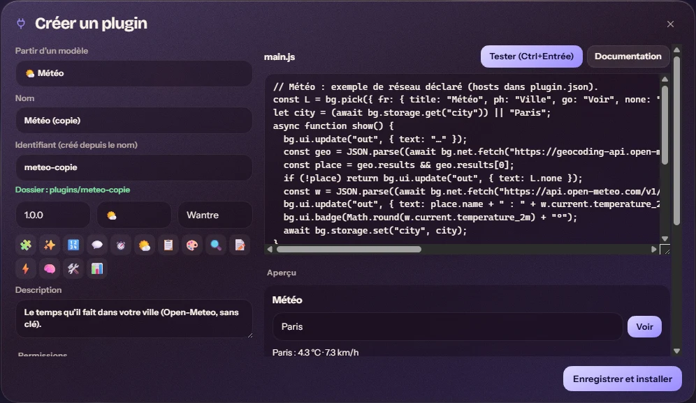 | **Créateur de plugins** : modèles, identifiant créé depuis le nom et vérifié pendant la saisie, icône, version, permissions expliquées, aperçu en direct (<kbd>Ctrl</kbd> <kbd>Entrée</kbd>). |
| 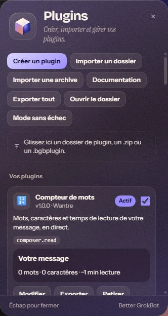 | **Plugins isolés** : chaque plugin tourne dans son propre Worker et ne fait que ce que déclarent ses permissions. Jamais vos clés, jetons ou fichiers. Paquets à glisser sur la fenêtre (dossier, .zip, .bgbplugin), galerie, export, mode sans échec. |
| 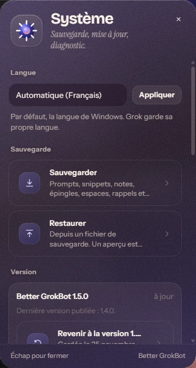 | **Huit langues** : français, anglais, espagnol, allemand, italien, portugais, néerlandais, polonais. La langue de Windows au premier lancement, à changer dans Système. |

Documentation des plugins : [en ligne](https://wantre.github.io/better-grokbot/plugins.html) et dans l’app (Plugins > Documentation). Le client MCP est reporté : il n’était pas assez fiable pour cette version. Détail dans [`CHANGELOG.md`](CHANGELOG.md).

Le site existe aussi en [English](https://wantre.github.io/better-grokbot/en/), [Español](https://wantre.github.io/better-grokbot/es/), [Deutsch](https://wantre.github.io/better-grokbot/de/), [Italiano](https://wantre.github.io/better-grokbot/it/), [Português](https://wantre.github.io/better-grokbot/pt/), [Nederlands](https://wantre.github.io/better-grokbot/nl/) et [Polski](https://wantre.github.io/better-grokbot/pl/).

## Nouveau dans la 1.4

| | |
|---|---|
| 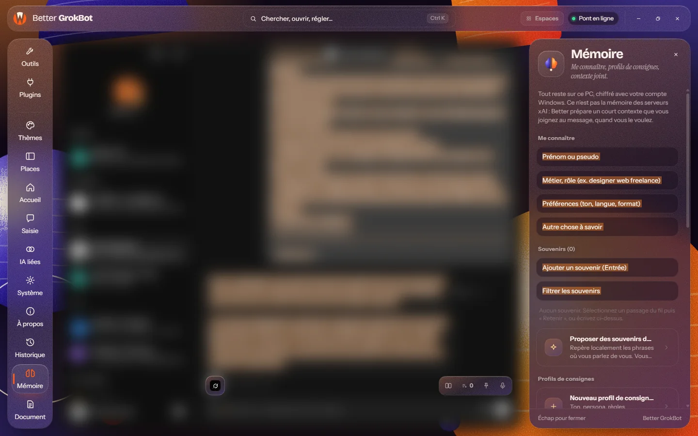 | **Mémoire « Me connaître »** : coffre chiffré avec votre compte Windows, souvenirs, profils de consignes, contexte joint quand vous le voulez. |
| 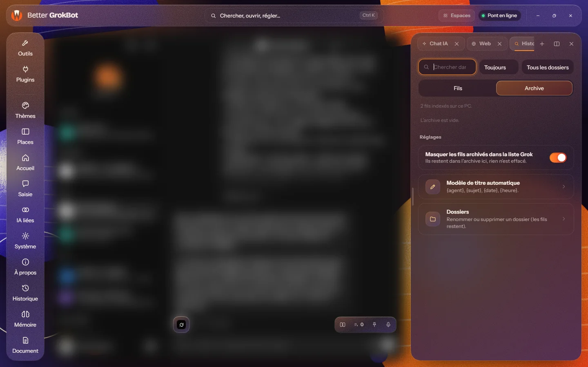 | **Historique** (<kbd>Ctrl</kbd> <kbd>Maj</kbd> <kbd>F</kbd>) : recherche dans tous les fils, titres automatiques, dossiers, étiquettes, archive. |
| 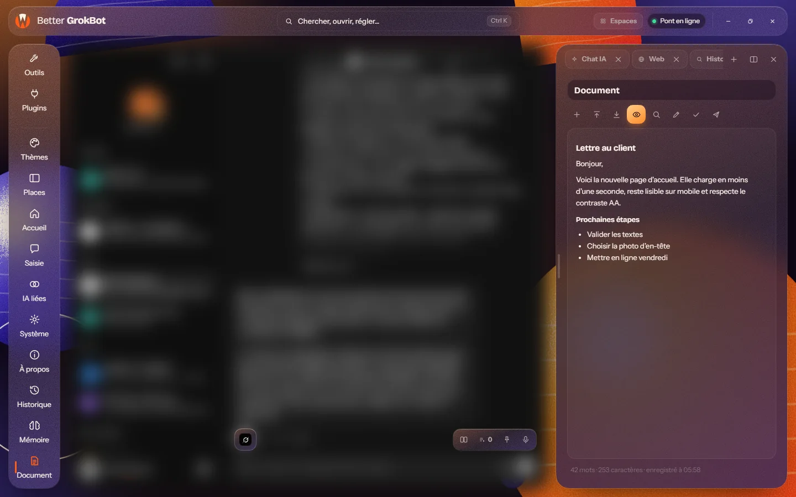 | **Document** (<kbd>Ctrl</kbd> <kbd>Maj</kbd> <kbd>O</kbd>) : volet d’écriture avec aperçu, retouche par Grok, enregistrement .md, .txt ou PDF. |
| 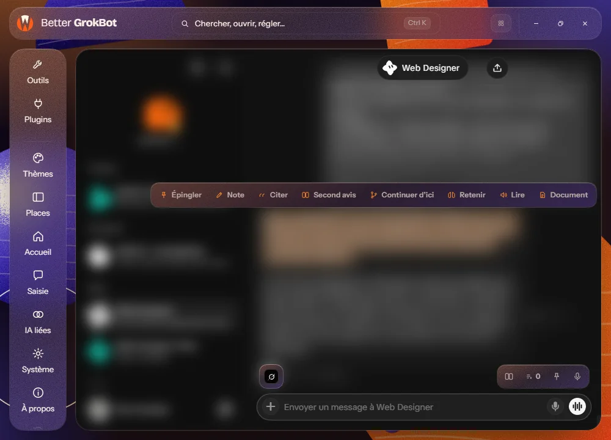 | **Sélection** : citer, retenir, lire à voix haute, envoyer au Document, continuer d’ici avec un autre agent. |
| 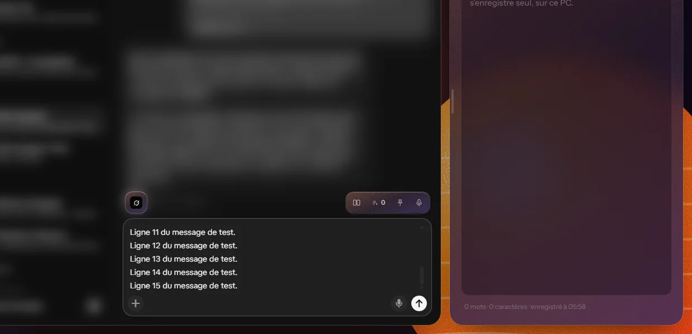 | **Compositeur** : la barre de droite et le rond « Répond » restent à 8 px au-dessus du champ, même avec un long texte. |

Aussi : projets avec dépôt GitHub cloné en local, rythme du quota, ZIP lus sur place, notification « Réponse prête », vidéos sans lecture automatique, saisie IME corrigée, mises à jour sans erreur EPERM. Détail dans [`CHANGELOG.md`](CHANGELOG.md).

## Nouveau dans la 1.3

| | |
|---|---|
|  | **Chat IA** : un volet de chat pour Cursor, Codex, Claude Code ou une IA locale, à côté de Grok. Modèles avec logos, conversations gardées sur le PC, Markdown, comparaison côte à côte. |
| 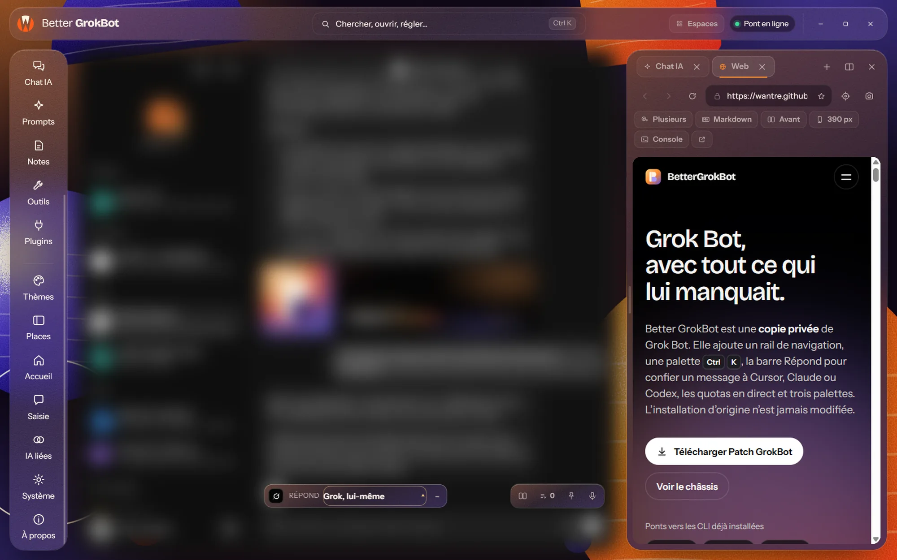 | **Navigateur Web** : une page à côté du fil ; le sélecteur envoie un élément et son image dans le champ de saisie. |
|  | **Répond** : carte fixe au-dessus du champ de saisie, liste avec logos, IA prêtes et à relier, recherche. |
| 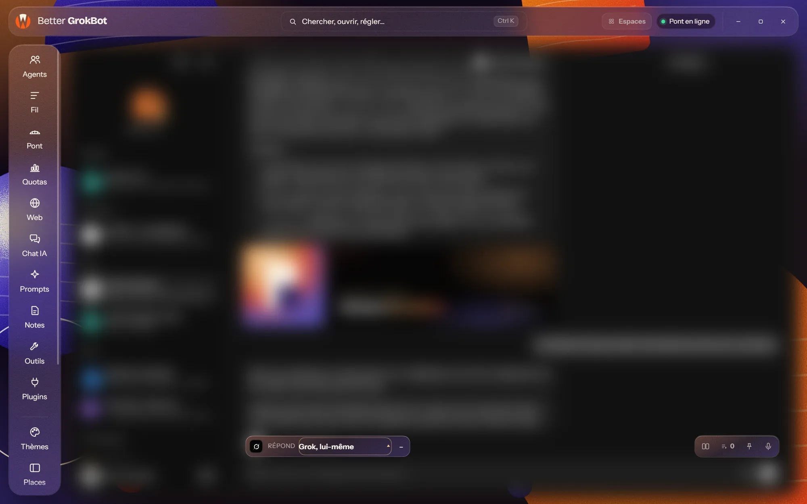 | **Rail** : noms toujours visibles en mode Simple, jamais en Compact ; il se range et défile sans marge. |
|  | **Mises à jour** : téléchargement, sha256, fermeture, patch et relance ; mise à jour automatique en option, quand rien ne tourne. |
| 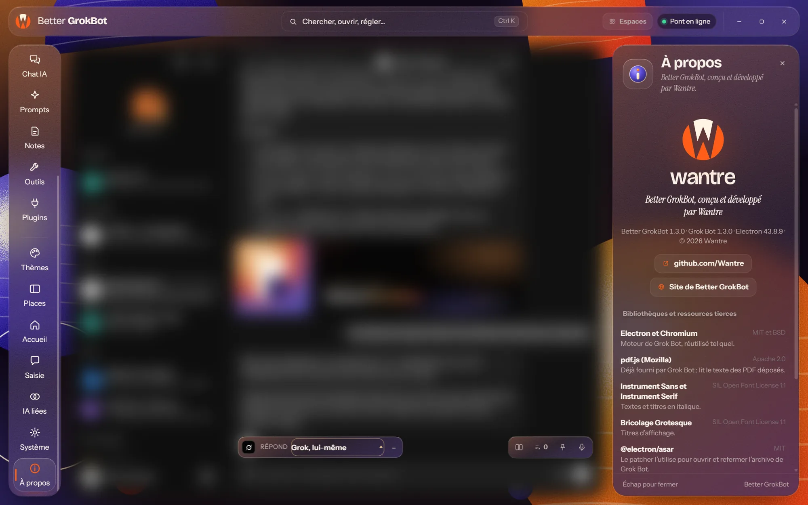 | **À propos** : version, liens et bibliothèques tierces. Conçu et développé par Wantre. |

Les captures sont réelles ; la conversation Grok y est floutée.

## Ce que la copie ajoute

| | |
|---|---|
| **Châssis** | Une barre de titre propre, un rail illustré à gauche, des panneaux qui glissent depuis la droite. Échap referme. |
| **Palette Ctrl K** | Toutes les entrées, les trois palettes de couleurs et les gestes du fil, au clavier. |
| **Répond** | Une barre au-dessus du champ de saisie pour confier un message à Cursor, Claude ou Codex. Grok reste l’agent qui vous parle. |
| **Pont** | L’état du serveur local, les CLI trouvées sur le PC et le modèle assigné à chaque agent. Les clés collées restent chiffrées. |
| **Quotas** | Le pourcentage Grok et la date de réinitialisation, puis la jauge de chaque pont lié quand sa CLI publie un chiffre. |
| **Chat IA** | Un volet de chat complet pour parler aux IA reliées (Cursor, Codex, Claude Code…) : choix du modèle avec logos, conversations gardées sur le PC, Markdown, comparaison côte à côte. |
| **Navigateur Web** | Un volet Web à côté de Grok, avec bloqueur de publicités intégré. Le sélecteur envoie un élément de la page, avec son image, dans le champ de saisie. |
| **Mises à jour** | Téléchargement, vérification sha256, fermeture, patch et relance, avec un voile de transition. Mise à jour automatique en option, quand rien ne tourne. |
| **Palettes** | Braise, Aube et Nuit, appliquées tout de suite. Grain, décor et animations se règlent à part. |

Seuls les ponts dont la CLI est vraiment installée apparaissent : Cursor, Claude Code, Codex, Gemini CLI, Copilot et OpenCode. Pas de clé API nécessaire pour eux.

<p align="center">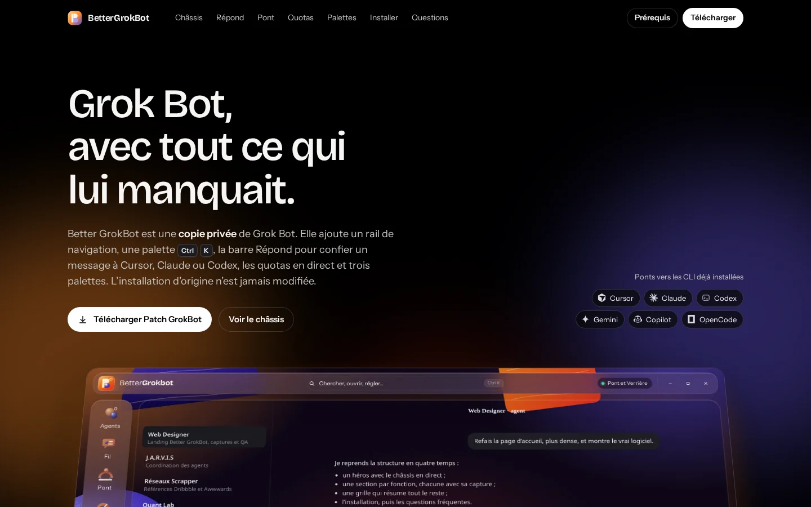</p>

## Télécharger

[Patch-GrokBot.exe](https://github.com/Wantre/better-grokbot/releases/latest/download/Patch-GrokBot.exe) installe toujours la dernière version. La [page des versions](https://github.com/Wantre/better-grokbot/releases/latest) donne aussi le paquet complet `.zip`, le paquet de mise à jour et `SHA256SUMS`. Chaque nouvelle version est annoncée sur Discord, dans le salon « mises-à-jour ». Les nouveautés sont dans [`CHANGELOG.md`](CHANGELOG.md).

## Communauté

Questions, idées et retours sur le serveur Discord : **https://discord.gg/D7CB6UePFD**

## La page

- Un seul fichier `index.html`, sans dépendance ni étape de build.
- Démo animée en six chapitres, sections par fonction, palettes interactives qui changent la capture et la couleur de la page.
- Animations douces, coupées quand le système demande de réduire les animations.
- Lisible au clavier, testée sur ordinateur et sur mobile, sans défilement horizontal.

Pour la voir en local :

```bash
python -m http.server 8000
# puis http://localhost:8000
```

## Publication

GitHub Pages sert la branche `main`, dossier racine. Le fichier `.nojekyll` empêche tout traitement Jekyll.

## Licence

Better GrokBot est sous **licence propriétaire Wantre — tous droits réservés** (voir [`LICENSE`](LICENSE)). Le téléchargement et l’usage personnel sont gratuits. Redistribuer, modifier, décompiler pour en faire une œuvre dérivée, revendre ou réutiliser le code ou la marque demande l’accord écrit de Wantre. Le logiciel est fourni tel quel, sans garantie.

Better GrokBot est un projet indépendant, non affilié à xAI, X ou Grok Bot ; Grok, Grok Bot, xAI et X sont des marques de leurs détenteurs. Les polices (SIL Open Font License), les icônes (Simple Icons) et les autres composants tiers gardent leurs propres licences.

---

<p align="center"><sub>© 2026 Better GrokBot · conçu et développé par <a href="https://github.com/Wantre">Wantre</a> · licence propriétaire, tous droits réservés · <a href="https://discord.gg/D7CB6UePFD">Discord</a></sub></p>
