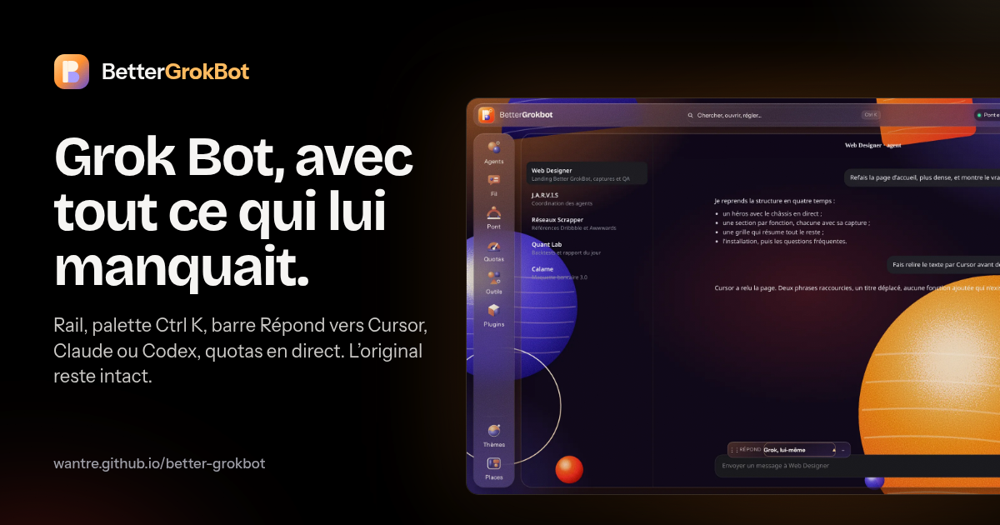
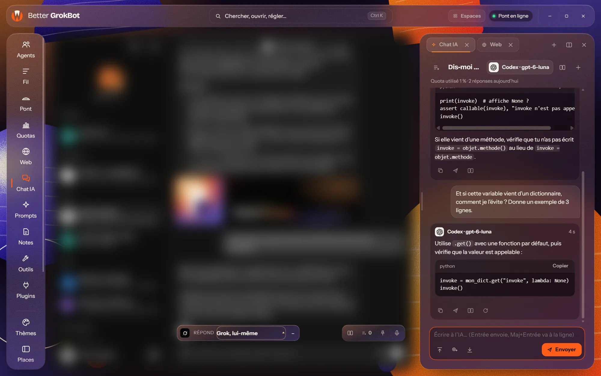
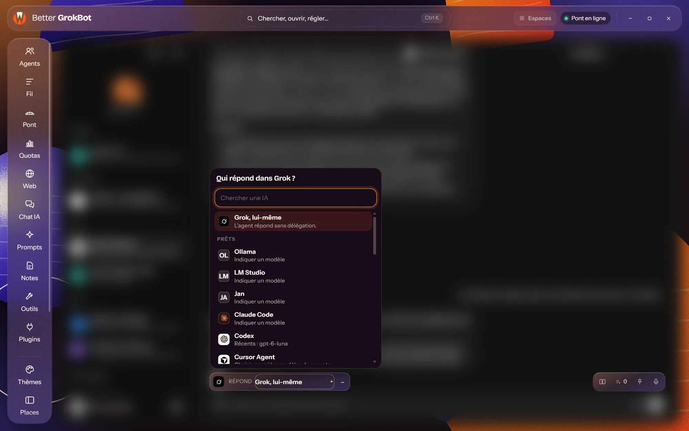
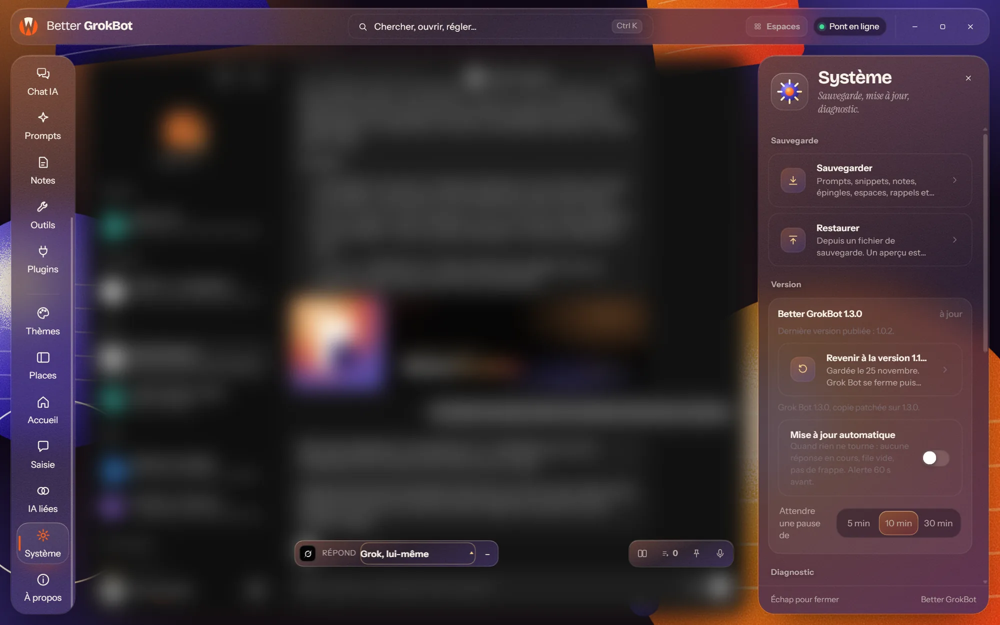

<p align="center">
  <a href="https://wantre.github.io/better-grokbot/"></a>
</p>

<h1 align="center">Better GrokBot</h1>

<p align="center">
  Grok Bot, avec un châssis complet : rail de navigation, Chat IA, navigateur Web, palette <kbd>Ctrl</kbd> <kbd>K</kbd>, barre Répond vers d’autres IA, quotas en direct et mises à jour automatiques.<br>
  <a href="https://wantre.github.io/better-grokbot/"><b>Voir le site</b></a> · <a href="https://github.com/Wantre/better-grokbot/releases/tag/v1.3.0">Télécharger la 1.3.0</a> · <a href="https://discord.gg/D7CB6UePFD">Discord</a>
</p>

---

Ce dépôt contient la page de présentation de Better GrokBot, publiée avec GitHub Pages, son manifeste de mise à jour et ses notes de version. Les paquets sont sur la page des versions.

Better GrokBot est une **copie privée** de Grok Bot. L’installation d’origine, dans `Programs\Grok Bot`, est lue sans jamais être modifiée. La copie vit à part et se retire en un clic.

## Nouveau dans la 1.3

| | |
|---|---|
|  | **Chat IA** : un volet de chat pour Cursor, Codex, Claude Code ou une IA locale, à côté de Grok. Modèles avec logos, conversations gardées sur le PC, Markdown, comparaison côte à côte. |
|  | **Navigateur Web** : une page à côté du fil ; le sélecteur envoie un élément et son image dans le champ de saisie. |
|  | **Répond** : carte fixe au-dessus du champ de saisie, liste avec logos, IA prêtes et à relier, recherche. |
|  | **Rail** : noms toujours visibles en mode Simple, jamais en Compact ; il se range et défile sans marge. |
|  | **Mises à jour** : téléchargement, sha256, fermeture, patch et relance ; mise à jour automatique en option, quand rien ne tourne. |
|  | **À propos** : version, liens et bibliothèques tierces. Conçu et développé par Wantre. |

Les captures sont réelles ; la conversation Grok y est floutée.

## Ce que la copie ajoute

| | |
|---|---|
| **Châssis** | Une barre de titre propre, un rail illustré à gauche, des panneaux qui glissent depuis la droite. Échap referme. |
| **Palette Ctrl K** | Toutes les entrées, les trois palettes de couleurs et les gestes du fil, au clavier. |
| **Répond** | Une barre au-dessus du champ de saisie pour confier un message à Cursor, Claude ou Codex. Grok reste l’agent qui vous parle. |
| **Pont** | L’état du serveur local, les CLI trouvées sur le PC et le modèle assigné à chaque agent. Les clés collées restent chiffrées. |
| **Quotas** | Le pourcentage Grok et la date de réinitialisation, puis la jauge de chaque pont lié quand sa CLI publie un chiffre. |
| **Chat IA** | Un volet de chat complet pour parler aux IA reliées (Cursor, Codex, Claude Code…) : choix du modèle avec logos, conversations gardées sur le PC, Markdown, comparaison côte à côte. |
| **Navigateur Web** | Un volet Web à côté de Grok. Le sélecteur envoie un élément de la page, avec son image, dans le champ de saisie. |
| **Mises à jour** | Téléchargement, vérification sha256, fermeture, patch et relance, avec un voile de transition. Mise à jour automatique en option, quand rien ne tourne. |
| **Palettes** | Braise, Aube et Nuit, appliquées tout de suite. Grain, décor et animations se règlent à part. |

Seuls les ponts dont la CLI est vraiment installée apparaissent : Cursor, Claude Code, Codex, Gemini CLI, Copilot et OpenCode. Pas de clé API nécessaire pour eux.

<p align="center"></p>

## Télécharger

La dernière version est sur la [page des versions](https://github.com/Wantre/better-grokbot/releases/latest) : le paquet complet `Better-GrokBot-1.3.0-Windows.zip`, le paquet de mise à jour et `SHA256SUMS`. Les nouveautés sont dans [`CHANGELOG.md`](CHANGELOG.md).

## Communauté

Questions, idées et retours sur le serveur Discord : **https://discord.gg/D7CB6UePFD**

## La page

- Un seul fichier `index.html`, sans dépendance ni étape de build.
- Démo animée en six chapitres, sections par fonction, palettes interactives qui changent la capture et la couleur de la page.
- Animations douces, coupées quand le système demande de réduire les animations.
- Lisible au clavier, testée sur ordinateur et sur mobile, sans défilement horizontal.

Pour la voir en local :

```bash
python -m http.server 8000
# puis http://localhost:8000
```

## Publication

GitHub Pages sert la branche `main`, dossier racine. Le fichier `.nojekyll` empêche tout traitement Jekyll.

## Licence

Better GrokBot est sous **licence propriétaire Wantre — tous droits réservés** (voir [`LICENSE`](LICENSE)). Le téléchargement et l’usage personnel sont gratuits. Redistribuer, modifier, décompiler pour en faire une œuvre dérivée, revendre ou réutiliser le code ou la marque demande l’accord écrit de Wantre. Le logiciel est fourni tel quel, sans garantie.

Better GrokBot est un projet indépendant, non affilié à xAI, X ou Grok Bot ; Grok, Grok Bot, xAI et X sont des marques de leurs détenteurs. Les polices (SIL Open Font License), les icônes (Simple Icons) et les autres composants tiers gardent leurs propres licences.

---

<p align="center"><sub>© 2026 Better GrokBot · conçu et développé par <a href="https://github.com/Wantre">Wantre</a> · licence propriétaire, tous droits réservés · <a href="https://discord.gg/D7CB6UePFD">Discord</a></sub></p>
